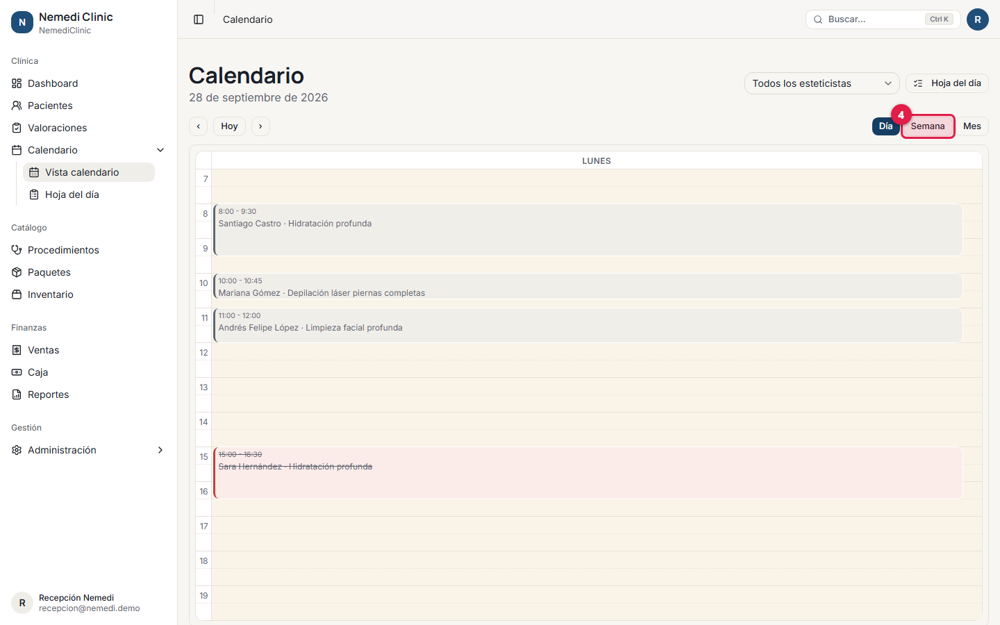
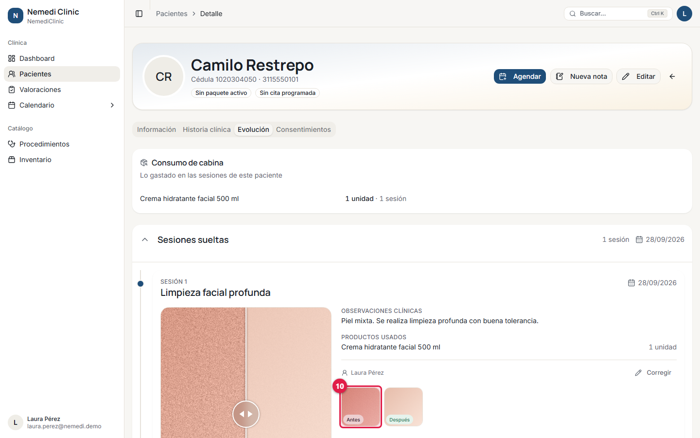
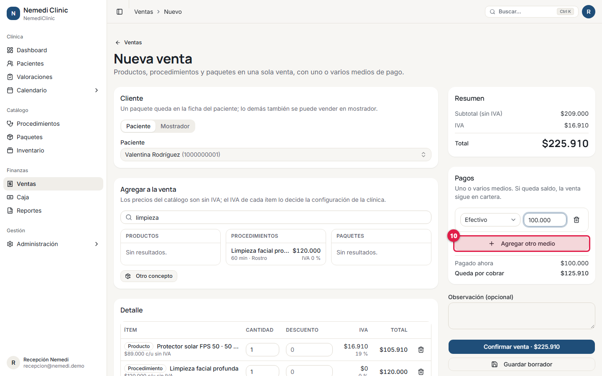
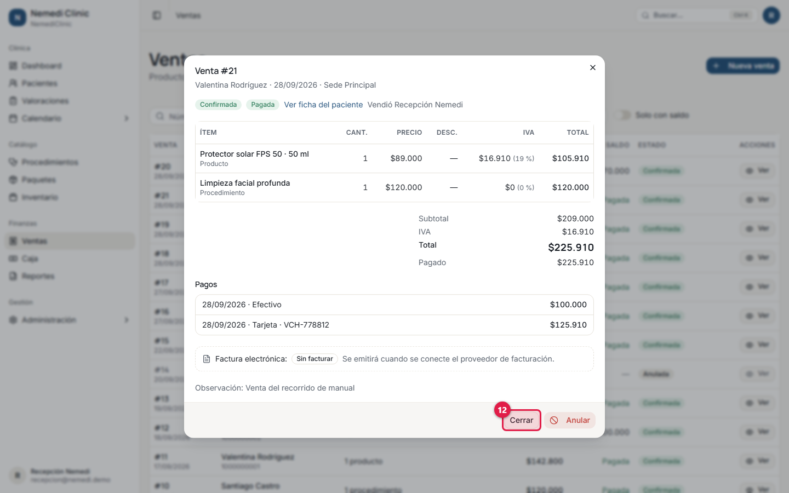
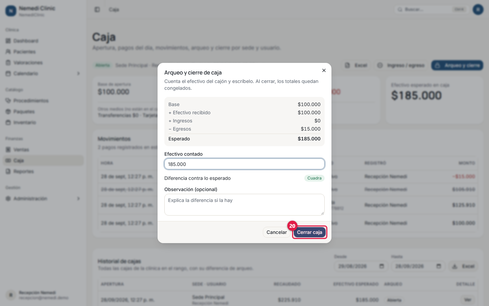
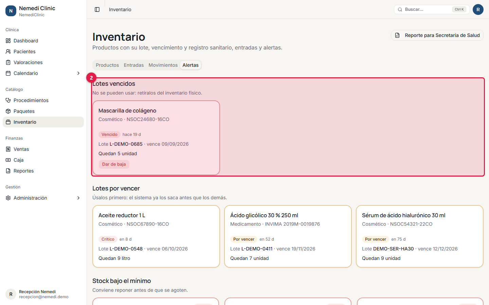
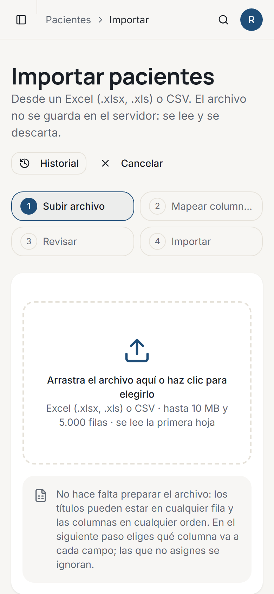

# NemediClinic

ERP/CRM multi-tenant para clínicas estéticas en Colombia. Reúne en una sola aplicación web la
agenda, la historia clínica, los paquetes de sesiones, el inventario por lotes, las ventas y la
caja, con aislamiento estricto de los datos de cada clínica.

Cada clínica es un tenant con sus sedes y tres roles (dueño, recepción y esteticista). Por encima
hay un nivel de plataforma para administrar las clínicas y los canales comerciales.

> **Sobre este repositorio.** Contiene el código de NemediClinic construido hasta hoy (API, interfaz
> web y pruebas), su documentación y capturas de la aplicación. No incluye los scripts de despliegue
> del servidor de producción ni las guías de uso en PDF.
>
> Todos los datos que aparecen en las capturas y en el código son ficticios: los genera el propio
> proyecto (datos de demostración y pruebas automatizadas). Ninguna contraseña ni llave está
> versionada: se pasan por variables de entorno o `user-secrets`, y una prueba revisa los formatos
> habituales en que una llave o contraseña se cuela en el repositorio.

## Capturas

| | |
|---|---|
|  |  |
| **Dashboard** con citas, pacientes activos y alertas de inventario | **Agenda** por sede y esteticista |
|  |  |
| **Evolución** de la sesión con comparador antes/después | **Nueva venta** con productos, procedimientos y varios medios de pago |
|  |  |
| **Detalle de venta** con IVA por línea | **Arqueo y cierre de caja** |
|  |  |
| **Inventario por lotes** con alertas de vencimiento | **Importación de pacientes** desde Excel o CSV (vista móvil) |
|  |  |
| **Hoja del día** de la esteticista (vista tablet) | **Instalación como PWA** |

## Funcionalidades principales

**Atención clínica**
- Pacientes con ficha, búsqueda e importación masiva desde Excel o CSV (mapeo de columnas, vista
  previa, detección de duplicados e historial de importaciones).
- Historia clínica con notas por sesión, fotos de antes y después con comparador, y evolución
  agrupada por paquete. Una nota se puede corregir durante 24 horas; después solo admite una nota
  aclaratoria.
- Valoraciones de prospectos y consentimiento informado con firma en pantalla y PDF generado.
- Agenda por sede y esteticista, con horario de la sede y cancelación con motivo.

**Catálogo e inventario**
- Procedimientos, paquetes de sesiones y productos, con importación desde archivo.
- Inventario por lotes con salida FEFO (primero el que vence antes), consumo de cabina ligado a la
  sesión, alertas de lotes vencidos o por vencer y reporte de trazabilidad sanitaria en Excel.

**Finanzas**
- Ventas de productos, procedimientos y paquetes con IVA por línea, varios medios de pago, abonos
  y anulación completa.
- Caja por usuario y sede: apertura, ingresos y egresos, arqueo y cierre.
- Reportes de ventas, procedimientos, producción por esteticista y cartera, con descarga en Excel.
- Facturación electrónica DIAN: **en desarrollo**. Existe la integración con un proveedor de
  facturación y las credenciales de cada clínica se guardan cifradas, pero el flujo de extremo a
  extremo todavía no está validado.

**Plataforma**
- Administración de clínicas con estado y suspensión por mora (la clínica queda en solo lectura).
- Canales comerciales con marca blanca (nombre, logo y colores).
- Registro de oportunidades con protección durante 90 días, de modo que otro canal no pueda
  registrar la misma clínica.

**Experiencia de uso**
- Interfaz adaptada a celular (verificada a 390 px de ancho) e instalable como PWA.
- Guías de uso por rol, ilustradas con las capturas que toma el recorrido automatizado de la
  interfaz (las guías no se incluyen en este repositorio; las capturas se regeneran con
  `pnpm test:ui`).

## Tecnologías

| Capa | Tecnología |
|---|---|
| Backend | .NET 10 (ASP.NET Core), Entity Framework Core 10, SQL Server |
| Autenticación | JWT con refresh token, contraseñas con BCrypt |
| Tareas programadas | Hangfire |
| Documentos | QuestPDF (consentimientos), ClosedXML y ExcelDataReader (Excel), ImageSharp (imágenes) |
| Frontend | React 19, TypeScript 6, Vite 8, TanStack Router y Query, Zustand, React Hook Form, Zod 4 |
| Interfaz | Tailwind CSS 4, shadcn/ui, FullCalendar 6, Recharts 3 |
| Pruebas | xUnit (unitarias), Playwright (API, interfaz por rol y móvil) |

## Arquitectura

El backend sigue una arquitectura por capas (`Api → Application / Infrastructure → Domain`) y el
frontend es una SPA en React que consume la API REST. Todas las entidades de clínica comparten una
base común con `TenantId`, fechas de auditoría, borrado lógico y control de concurrencia.

El detalle, con diagrama, está en [docs/arquitectura.md](docs/arquitectura.md).

### Seguridad y privacidad de los datos

Por tratarse de datos de salud, la seguridad se resuelve en el backend y se verifica con pruebas:

- **Aislamiento entre clínicas.** El tenant viaja en el JWT y un filtro global de EF Core lo
  aplica a todas las consultas junto con el borrado lógico. El `TenantId` se asigna al guardar y
  nunca se toma del cuerpo de la petición. Una prueba de extremo a extremo crea dos clínicas y
  comprueba que ninguna lee ni modifica datos de la otra; es parte de `pnpm test`
  (`tests/e2e/tenant-isolation.spec.ts`).
- **Autorización por rol en el servidor.** Políticas para dueño, recepción, esteticista y
  administrador de plataforma. El administrador de plataforma no tiene tenant y un middleware lo
  mantiene fuera de los datos clínicos.
- **Gestión de usuarios con reglas en el servidor.** Crear usuarios exige la sesión del dueño o de
  recepción (no hay registro anónimo). Recepción solo crea esteticistas, y fuera de sus propios datos
  solo edita, desactiva, borra o restablece la clave de esteticistas; nadie se asigna un rol mayor que el suyo ni cambia su propio rol, nadie se
  desactiva ni se borra a sí mismo y la clínica siempre conserva un dueño activo. La sede de un
  usuario tiene que ser de su misma clínica, y un correo identifica una sola cuenta en todo el
  sistema (todas las clínicas y los administradores de plataforma), porque el inicio de sesión lo
  busca en todas. Las reglas viven en `UserRules` y tienen pruebas unitarias y de extremo a extremo.
- **Sesión revalidada en cada petición.** El JWT dura hasta 60 minutos, pero en cada petición
  autenticada la API lee la cuenta en la base: si se desactivó o se borró, si cambió de rol o de
  clave, o si su clínica dejó de estar activa, el token se rechaza aunque no haya vencido. El
  refresh token solo renueva una cuenta activa de una clínica activa, con su rol actual, y no sirve
  después de un cambio de clave (el JWT lleva un sello derivado del hash de la clave).
- **Contraseñas.** Hash con BCrypt, longitud mínima, cambio obligatorio en el primer ingreso y
  contraseñas temporales que se entregan una sola vez. Con la clave temporal la API solo permite
  cambiarla (lo exige un middleware, no solo la interfaz). Cambiar o restablecer una contraseña
  cierra las sesiones abiertas de esa cuenta.
- **Límite de intentos en el inicio de sesión.** Login, renovación de sesión y cambio de clave
  comparten un cupo por IP (30 peticiones por minuto fuera de desarrollo; IPv6 por /64). Además se
  cuentan las claves equivocadas por cuenta: 10 desde la misma IP la bloquean desde esa IP durante
  15 minutos, cada fallo responde con un retardo que se duplica (hasta 10 segundos) y 100 en una
  hora bloquean la cuenta. Para no dejar por fuera al dueño durante un ataque, ese último bloqueo no
  aplica al navegador donde ya entró: tras un ingreso correcto recibe una cookie de dispositivo
  conocido (HttpOnly, Secure, SameSite=Strict, válida 60 días, firmada con una subllave HKDF y
  ligada a la clave actual), con su propio bloqueo corto. Los valores se ajustan en
  `RateLimiting:Auth`. Los contadores viven en la memoria del proceso: con varias instancias de la
  API cada una lleva su cuenta, y un reinicio los pone en cero.
- **Proxies de confianza.** La API solo acepta `X-Forwarded-For/Proto/Host` de los proxies
  declarados en `ForwardedHeaders:KnownProxies` (IPs) o `ForwardedHeaders:KnownNetworks` (redes);
  sin esa configuración las ignora y usa la IP de la conexión, así que nadie fija su IP (para
  esquivar el límite de intentos) ni el dominio con el que se elige la marca del canal. Una red más
  amplia que /8 en IPv4 (/32 en IPv6) o una dirección sin especificar detienen el arranque. En
  Docker, Caddy tiene una IP fija dentro de la red del compose y es el único proxy declarado.
- **Archivos clínicos.** Las fotos y los comprobantes no se sirven como archivos estáticos: se
  entregan mediante URL firmada (HMAC-SHA256) con vigencia de 10 minutos y ligada al tenant. El tipo
  de archivo se valida por su contenido y no por la extensión, y a las imágenes se les eliminan los
  metadatos EXIF, IPTC y XMP.
- **Imágenes solo JPEG, PNG y WebP.** ImageSharp decodifica con una configuración que solo carga
  esos tres formatos; los decodificadores de TIFF, BMP, GIF y demás no están disponibles aunque un
  archivo de ese tipo pasara el filtro de contenido. `BannedSymbols.txt` prohíbe en compilación
  cargar imágenes sin esa configuración y usar la ecualización de histograma. La versión se queda en
  3.1.12 y no se sube a 3.2, que cierra los avisos de seguridad de 3.1.12, porque desde 3.2 la
  biblioteca exige una licencia de Six Labors y la compilación en Release falla sin ella. Los avisos
  altos de 3.1.12 quedan fuera de alcance (están en el códec TIFF, que no se carga, o en la
  ecualización de histograma, que no se usa); sigue abierto uno moderado sobre perfiles de color
  ICC (GHSA-gwg2-r3hj-4w44), que puede traer un JPEG, PNG o WebP y se cierra al subir a 3.2.
- **Secretos de terceros cifrados.** Las credenciales de facturación de cada clínica se guardan
  con AES-GCM y una clave derivada con HKDF.
- **Arranque seguro en producción.** La API se niega a iniciar con la clave JWT de desarrollo o con
  una de menos de 32 caracteres, con CORS con comodines o con las carpetas de archivos, logs o
  configuración dentro de la carpeta que el servidor web publica. Los endpoints de desarrollo
  responden 404 fuera de ese entorno y Swagger solo se habilita en desarrollo.

Planeado en este frente: auditoría de accesos (ver "Próximos pasos").

## Estructura del repositorio

| Ruta | Contenido |
|---|---|
| `apps/api/` | API en .NET 10: `src/` (Api, Application, Domain e Infrastructure, con las migraciones de EF Core) y `tests/NemediClinic.Tests` (xUnit) |
| `apps/web/` | Interfaz web en React y Vite, instalable como PWA |
| `tests/e2e/` | Pruebas Playwright: API, recorrido de la interfaz por rol, móvil, asistente de importación y facturación |
| `deploy/` | Despliegue con Docker Compose (SQL Server, API, web con nginx y Caddy) y respaldo de la base |
| `docs/` | Arquitectura, capturas y especificación OpenAPI del inicio de sesión |

## Cómo compilar y probar

Requisitos: .NET SDK 10 (versión fijada en `global.json`), Node.js 20.19 o 22.12 en adelante y pnpm.

### API y pruebas unitarias

```bash
dotnet build apps/api/NemediClinic.sln
dotnet test apps/api/tests/NemediClinic.Tests
```

No necesitan base de datos. Entre las pruebas está `SinSecretosVersionadosTests`, que detecta los
formatos habituales de una llave, una contraseña o un correo personal versionados (llaves privadas y
de API conocidas, contraseñas en cadenas de conexión, secretos en JSON, `.env` y YAML, literales,
valores por defecto y configuración armada en código) y muestra solo archivo, línea y tipo, nunca el valor. No sustituye una
revisión: un secreto con otra forma puede pasar.

### Interfaz web

```bash
cd apps/web
pnpm install --frozen-lockfile
pnpm build
```

### Correr la aplicación en local

Necesita SQL Server. En desarrollo la API usa la instancia `localhost\SQL2022` y la base
`NemediClinic_Dev` con autenticación de Windows (`appsettings.Development.json`); otra conexión se
pasa en `ConnectionStrings__DefaultConnection`.

1. Define las claves de desarrollo como variables de entorno (ninguna se versiona):

   | Variable | Para qué | Mínimo |
   |---|---|---|
   | `Demo__Password` | Clave de las cuentas demo (dueño y esteticistas) que deja `POST /api/v1/dev/seed-demo` | 8 caracteres, con letras y números |
   | `Platform__AdminPassword` | Clave del administrador de plataforma (`platform@example.com`), que la API crea al arrancar si no existe | 10 caracteres |
   | `Jobs__ApiKey` | Clave para `POST /api/v1/jobs/{nombre}` | 32 caracteres |

   ```bash
   # bash
   export Demo__Password='<clave-demo>' Platform__AdminPassword='<clave-plataforma>'
   export Jobs__ApiKey="$(openssl rand -base64 48)"
   ```

   ```powershell
   # PowerShell
   $env:Demo__Password = '<clave-demo>'; $env:Platform__AdminPassword = '<clave-plataforma>'
   $b = New-Object byte[] 48; [Security.Cryptography.RandomNumberGenerator]::Create().GetBytes($b)
   $env:Jobs__ApiKey = [Convert]::ToBase64String($b)
   ```

   Para la API sola también sirve `dotnet user-secrets set "Demo:Password" "<clave-demo>" --project
   apps/api/src/NemediClinic.Api`; las pruebas e2e, en cambio, las leen del entorno.

2. Crea el esquema con las migraciones:

   ```bash
   dotnet tool install --global dotnet-ef
   dotnet ef database update --project apps/api/src/NemediClinic.Infrastructure --startup-project apps/api/src/NemediClinic.Api
   ```

3. Arranca la API (`http://localhost:5055`, Swagger en `/swagger`) y la web
   (`http://localhost:5173`, que reenvía `/api` a la API):

   ```bash
   dotnet run --project apps/api/src/NemediClinic.Api
   cd apps/web && pnpm dev
   ```

4. Crea la clínica demo (estos endpoints solo existen en Development):

   ```bash
   curl -X POST http://localhost:5055/api/v1/auth/seed -H "Content-Type: application/json" \
     -d '{"tenantNombre":"Clínica Demo","tenantNit":"900000000-0","tenantEmail":"clinica@example.com",
          "adminNombre":"Admin","adminApellido":"Demo","adminEmail":"admin@nemedi.demo",
          "adminPassword":"<clave-demo>"}'
   curl -X POST http://localhost:5055/api/v1/dev/seed-demo
   ```

   Después se entra con `admin@nemedi.demo` (dueño), `laura.perez@nemedi.demo` o
   `camila.ruiz@nemedi.demo` (esteticistas), todas con la clave de `Demo__Password`.

### Pruebas end-to-end (Playwright)

Necesitan lo anterior (esquema creado y clínica demo sembrada), `sqlcmd` en el `PATH` con
autenticación de Windows (las pruebas consultan y limpian la base directamente; `E2E_SQL_SERVER` y
`E2E_SQL_DATABASE` cambian la instancia y la base) y el navegador de Playwright. Si la API o la web
no están corriendo, Playwright las levanta con las variables del mismo entorno.

```bash
pnpm install --frozen-lockfile
pnpm exec playwright install chromium
pnpm test           # pruebas unitarias + pruebas de API (aislamiento, reglas de negocio, caja, jobs,
                    # gestión de usuarios, límite de intentos…)
pnpm test:ui        # recorrido de la interfaz por rol; deja una captura por paso en docs/manual/img
pnpm test:mobile    # sin scroll horizontal a 390 px en todas las rutas y roles
pnpm test:wizard    # asistente de importación de pacientes
pnpm test:factus    # facturación electrónica contra el sandbox de Factus
```

Las credenciales salen de `tests/e2e/credentials.ts`, que las lee del entorno:
`E2E_SUPERADMIN_EMAIL` (por defecto `admin@nemedi.demo`), `E2E_SUPERADMIN_PASSWORD` (o
`Demo__Password`), `E2E_PLATFORM_PASSWORD` (o `Platform__AdminPassword`) y `E2E_JOBS_KEY` (o
`Jobs__ApiKey`). Los usuarios que crea cada prueba reciben una contraseña aleatoria.
`pnpm test:factus` necesita además las credenciales de un ambiente sandbox de Factus en
`Factus__ClientId`, `Factus__ClientSecret`, `Factus__Username` y `Factus__Password`; sin ellas, esa
prueba se salta. El NIT del emisor que configura la prueba es ficticio (`999000001`); si el sandbox
exige el NIT de la cuenta, pásalo en `E2E_FACTUS_EMISOR_NIT`.

### Despliegue

`deploy/` trae la variante con Docker Compose: copia `deploy/.env.example` a `deploy/.env`, completa
los valores y corre `docker compose --env-file .env up -d --build` desde `deploy/`. En Production la
API exige un `Jwt__Secret` propio de 32 caracteres o más y no expone los endpoints de desarrollo.
El compose fija la subred de su red (`COMPOSE_SUBNET`) y la IP de Caddy dentro de ella (`CADDY_IP`),
que es el único proxy del que la API acepta `X-Forwarded-*`; si la subred choca con otra red del
servidor, se cambian las dos juntas y se recrea la red.
La instalación de producción actual corre en IIS; sus scripts no están en este repositorio.

### Limitaciones conocidas

- Un script SQL generado con `dotnet ef migrations script` (idempotente o no) no sirve para crear
  una base vacía: `AddPlatformLevel` y `AddSalesAndCash` hacen un `UPDATE` sobre una columna que
  agregan en la misma migración, y SQL Server compila el lote completo antes de ejecutarlo y lo
  rechaza. Para una base nueva usa `dotnet ef database update` (o
  `Database__MigrateOnStartup=true` en Docker), que ejecuta sentencia por sentencia.
- Las pruebas end-to-end acceden a la base con `sqlcmd` y autenticación de Windows.

## Estado del proyecto

En desarrollo activo. Según el estado declarado del proyecto, los módulos de clínica (pacientes,
historia clínica, agenda, paquetes, inventario, ventas, caja, reportes y configuración) están
implementados en backend y frontend. Cada rol tiene recorridos automatizados de la interfaz con
Playwright, que son además los que generan las capturas y las guías de uso. La facturación
electrónica está en desarrollo.

Próximos pasos:

- Generación del archivo RIPS.
- Notas crédito y devoluciones parciales (hoy una venta solo se anula completa).
- Auditoría de accesos.
- Almacenamiento de archivos en un servicio de objetos (hoy disco local detrás de una interfaz).
- Aplicación móvil nativa (sin iniciar).

## Autor

**Juan Diego Vargas** — Ingeniero de sistemas, especialista en seguridad de la información.
[github.com/JuanchoVargas](https://github.com/JuanchoVargas)

## Licencia

© Juan Diego Vargas. Todos los derechos reservados. El código se publica para consulta; no se
concede licencia para usarlo, copiarlo ni distribuirlo.

Algunas dependencias tienen licencias con condiciones propias para uso comercial: QuestPDF (se usa
con la licencia Community) e ImageSharp (Six Labors Split License). Revísalas antes de usar el
proyecto en producción.
