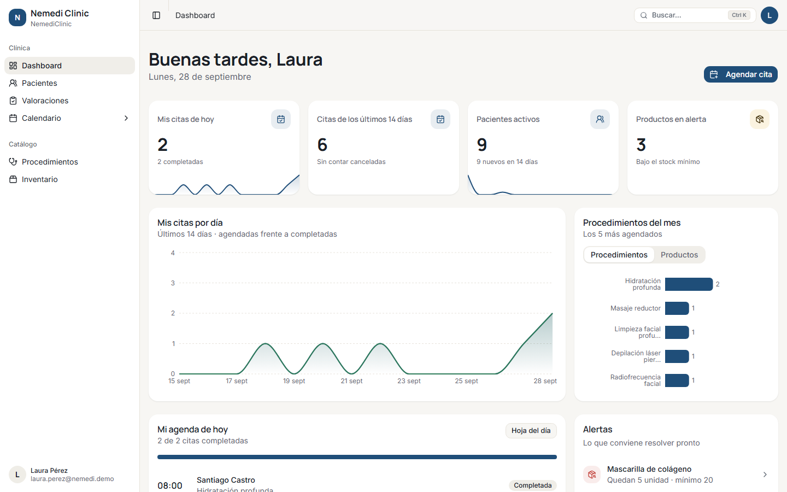
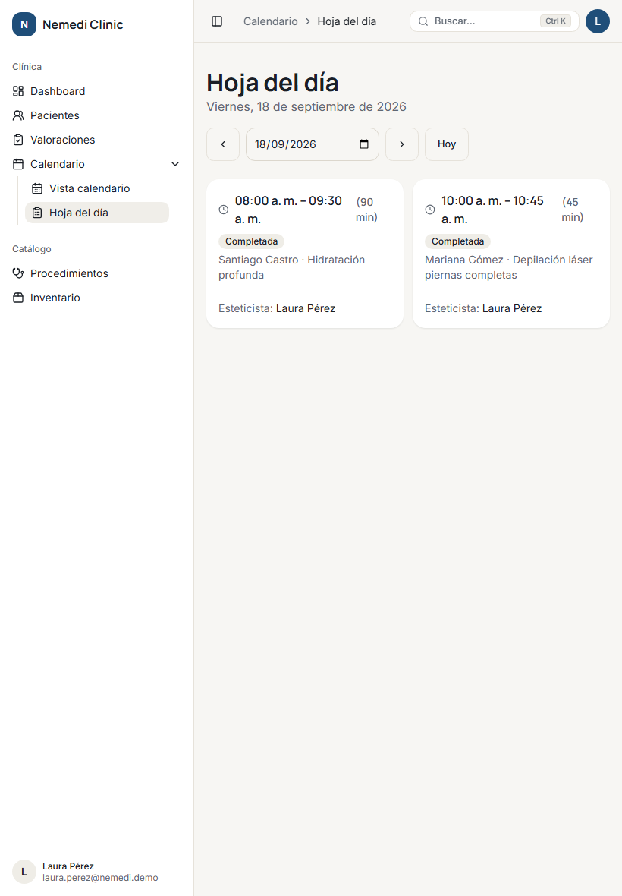
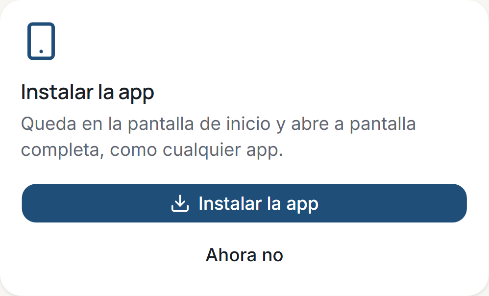

# NemediClinic

ERP/CRM multi-tenant para clínicas estéticas en Colombia. Reúne en una sola aplicación web la
agenda, la historia clínica, los paquetes de sesiones, el inventario por lotes, las ventas y la
caja, con aislamiento estricto de los datos de cada clínica.

Cada clínica es un tenant con sus sedes y tres roles (dueño, recepción y esteticista). Por encima
hay un nivel de plataforma para administrar las clínicas y los canales comerciales.

> **Sobre este repositorio.** El código fuente de NemediClinic es privado. Este repositorio es una
> vitrina: describe el producto, su arquitectura y sus decisiones de seguridad, y muestra capturas
> de la aplicación. El código se puede mostrar a solicitud.
>
> Todos los datos que aparecen en las capturas son ficticios: los genera el propio proyecto (datos
> de demostración y pruebas automatizadas).

## Capturas

| | |
|---|---|
|  |  |
| **Dashboard** con citas, pacientes activos y alertas de inventario | **Agenda** por sede y esteticista |
|  |  |
| **Evolución** de la sesión con comparador antes/después | **Nueva venta** con productos, procedimientos y varios medios de pago |
|  |  |
| **Detalle de venta** con IVA por línea | **Arqueo y cierre de caja** |
|  |  |
| **Inventario por lotes** con alertas de vencimiento | **Importación de pacientes** desde Excel o CSV (vista móvil) |
|  |  |
| **Hoja del día** de la esteticista (vista tablet) | **Instalación como PWA** |

## Funcionalidades principales

**Atención clínica**
- Pacientes con ficha, búsqueda e importación masiva desde Excel o CSV (mapeo de columnas, vista
  previa, detección de duplicados e historial de importaciones).
- Historia clínica con notas por sesión, fotos de antes y después con comparador, y evolución
  agrupada por paquete. Una nota se puede corregir durante 24 horas; después solo admite una nota
  aclaratoria.
- Valoraciones de prospectos y consentimiento informado con firma en pantalla y PDF generado.
- Agenda por sede y esteticista, con horario de la sede y cancelación con motivo.

**Catálogo e inventario**
- Procedimientos, paquetes de sesiones y productos, con importación desde archivo.
- Inventario por lotes con salida FEFO (primero el que vence antes), consumo de cabina ligado a la
  sesión, alertas de lotes vencidos o por vencer y reporte de trazabilidad sanitaria en Excel.

**Finanzas**
- Ventas de productos, procedimientos y paquetes con IVA por línea, varios medios de pago, abonos
  y anulación completa.
- Caja por usuario y sede: apertura, ingresos y egresos, arqueo y cierre.
- Reportes de ventas, procedimientos, producción por esteticista y cartera, con descarga en Excel.
- Facturación electrónica DIAN: **en desarrollo**. Existe la integración con un proveedor de
  facturación y las credenciales de cada clínica se guardan cifradas, pero el flujo de extremo a
  extremo todavía no está validado.

**Plataforma**
- Administración de clínicas con estado y suspensión por mora (la clínica queda en solo lectura).
- Canales comerciales con marca blanca (nombre, logo y colores).
- Registro de oportunidades con protección durante 90 días, de modo que otro canal no pueda
  registrar la misma clínica.

**Experiencia de uso**
- Interfaz adaptada a celular (verificada a 390 px de ancho) e instalable como PWA.
- Guías de uso por rol en PDF, generadas a partir del recorrido automatizado de la interfaz.

## Tecnologías

| Capa | Tecnología |
|---|---|
| Backend | .NET 10 (ASP.NET Core), Entity Framework Core 10, SQL Server |
| Autenticación | JWT con refresh token, contraseñas con BCrypt |
| Tareas programadas | Hangfire |
| Documentos | QuestPDF (consentimientos), ClosedXML y ExcelDataReader (Excel), ImageSharp (imágenes) |
| Frontend | React 19, TypeScript 6, Vite 8, TanStack Router y Query, Zustand, React Hook Form, Zod 4 |
| Interfaz | Tailwind CSS 4, shadcn/ui, FullCalendar 6, Recharts 3 |
| Pruebas | xUnit (unitarias), Playwright (API, interfaz por rol y móvil) |

## Arquitectura

El backend sigue una arquitectura por capas (`Api → Application / Infrastructure → Domain`) y el
frontend es una SPA en React que consume la API REST. Todas las entidades de clínica comparten una
base común con `TenantId`, fechas de auditoría, borrado lógico y control de concurrencia.

El detalle, con diagrama, está en [docs/arquitectura.md](docs/arquitectura.md).

### Seguridad y privacidad de los datos

Por tratarse de datos de salud, la seguridad se resuelve en el backend y se verifica con pruebas:

- **Aislamiento entre clínicas.** El tenant viaja en el JWT y un filtro global de EF Core lo
  aplica a todas las consultas junto con el borrado lógico. El `TenantId` se asigna al guardar y
  nunca se toma del cuerpo de la petición. Una prueba de extremo a extremo crea dos clínicas y
  comprueba que ninguna lee ni modifica datos de la otra; corre antes de cada `git push`.
- **Autorización por rol en el servidor.** Políticas para dueño, recepción, esteticista y
  administrador de plataforma. El administrador de plataforma no tiene tenant y un middleware lo
  mantiene fuera de los datos clínicos.
- **Contraseñas.** Hash con BCrypt, longitud mínima, cambio obligatorio en el primer ingreso
  (exigido por un middleware, no solo por la interfaz) y contraseñas temporales que se entregan una
  sola vez. Cambiar o restablecer una contraseña invalida los refresh tokens vigentes.
- **Archivos clínicos.** Las fotos y los comprobantes no se sirven como archivos estáticos: se
  entregan mediante URL firmada (HMAC-SHA256) con vigencia de 10 minutos y ligada al tenant. El tipo
  de archivo se valida por su contenido y no por la extensión, y a las imágenes se les eliminan los
  metadatos EXIF, IPTC y XMP.
- **Secretos de terceros cifrados.** Las credenciales de facturación de cada clínica se guardan
  con AES-GCM y una clave derivada con HKDF.
- **Arranque seguro en producción.** La API se niega a iniciar con la clave JWT de desarrollo o con
  una de menos de 32 caracteres, con CORS con comodines o con las carpetas de archivos, logs o
  configuración dentro de la carpeta que el servidor web publica. Los endpoints de desarrollo
  responden 404 fuera de ese entorno y Swagger solo se habilita en desarrollo.

Planeado en este frente: controles de abuso del inicio de sesión y auditoría de accesos (ver
"Próximos pasos").

## Estado del proyecto

En desarrollo activo. Según el estado declarado del proyecto, los módulos de clínica (pacientes,
historia clínica, agenda, paquetes, inventario, ventas, caja, reportes y configuración) están
implementados en backend y frontend. Cada rol tiene recorridos automatizados de la interfaz con
Playwright, que son además los que generan las capturas y las guías de uso. La facturación
electrónica está en desarrollo.

Próximos pasos:

- Generación del archivo RIPS.
- Notas crédito y devoluciones parciales (hoy una venta solo se anula completa).
- Controles de abuso del inicio de sesión y auditoría de accesos.
- Almacenamiento de archivos en un servicio de objetos (hoy disco local detrás de una interfaz).
- Aplicación móvil nativa (sin iniciar).

## Autor

**Juan Diego Vargas** — Ingeniero de sistemas, especialista en seguridad de la información.
[github.com/JuanchoVargas](https://github.com/JuanchoVargas)

## Licencia

© Juan Diego Vargas. Todos los derechos reservados. Este repositorio contiene solo documentación y
capturas; no incluye el código fuente.
