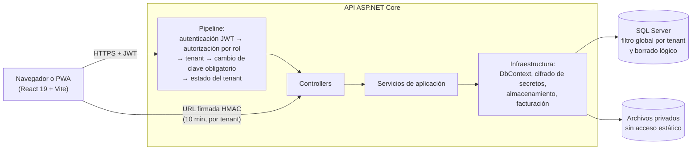
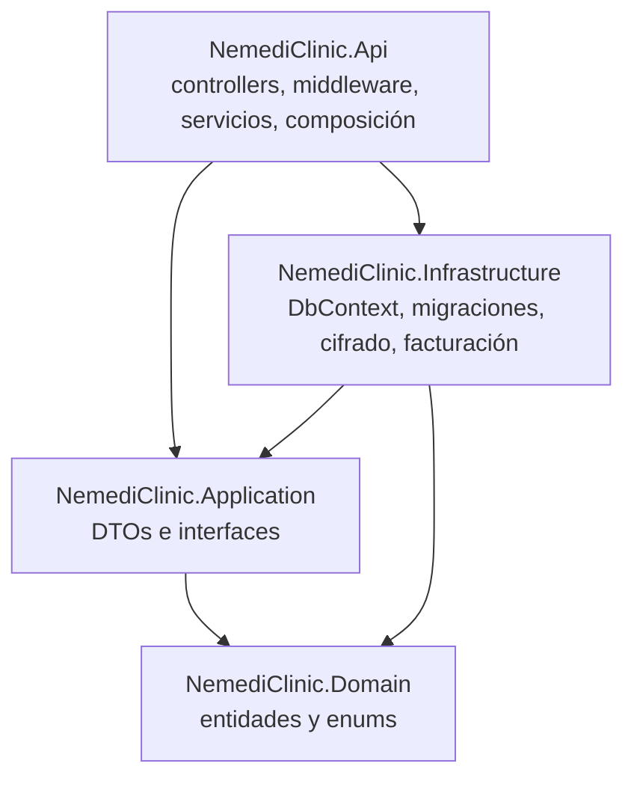

# Arquitectura de NemediClinic

Este documento describe cómo está construido NemediClinic: sus capas, el modelo de datos a alto
nivel, el aislamiento entre clínicas y las decisiones de seguridad. Todo lo que aquí se afirma
está implementado en el código fuente (privado).

## Vista general

NemediClinic es una aplicación web con dos piezas:

- **API REST** en ASP.NET Core (.NET 10) con Entity Framework Core 10 sobre SQL Server.
- **SPA** en React 19 con TypeScript y Vite, que consume la API y se puede instalar como PWA.

Los archivos subidos (fotos clínicas y comprobantes) se guardan en un almacenamiento privado detrás
de una interfaz (`IFileStorage`); hoy la implementación es disco local, fuera de la carpeta que el
servidor web publica.

## Capas del backend

La solución sigue una arquitectura por capas con dependencias en un solo sentido:

- **Domain** no depende de ningún otro proyecto ni paquete.
- **Application** solo conoce a Domain: no depende de EF Core.
- **Infrastructure** implementa las interfaces de Application (persistencia, cifrado de secretos,
  proveedor de facturación).
- **Api** compone todo en `Program.cs`. Los módulos más recientes usan controllers delgados que
  delegan en servicios; los más antiguos todavía tienen parte de la lógica en el controller. No hay
  capa de repositorios: los servicios usan el `DbContext` directamente.

## Modelo de datos a alto nivel

Todas las entidades de clínica heredan de una base común con `TenantId`, fechas de creación y
actualización, borrado lógico (`IsDeleted`) y un `RowVersion` que EF Core usa como control de
concurrencia optimista.

| Grupo | Entidades principales |
|---|---|
| Clínica | Tenant, sedes, horarios de sede, usuarios |
| Atención | Pacientes, historia clínica, notas clínicas (con productos usados), valoraciones, plantillas de consentimiento y consentimientos, citas, adjuntos |
| Catálogo e inventario | Procedimientos, paquetes, productos, lotes, entradas y movimientos de inventario |
| Paquetes del paciente | Paquetes asignados y sus sesiones |
| Finanzas | Ventas y sus líneas, pagos, sesiones de caja y movimientos, facturas electrónicas y su configuración |
| Plataforma | Canales comerciales, oportunidades, administradores de plataforma, ejecuciones de tareas programadas |

Las entidades de plataforma no pertenecen a ningún tenant y quedan por fuera del filtro global.

## Multi-tenant

Cada clínica es un tenant. El aislamiento se aplica en tres puntos:

1. **Identidad.** El JWT de un usuario de clínica lleva el claim `tenant_id`. Un middleware rechaza
   cualquier petición autenticada sin ese claim, salvo la del administrador de plataforma, que solo
   puede usar las rutas de plataforma.
2. **Lectura.** Al construir el modelo, el `DbContext` registra en cada entidad de clínica un filtro
   global equivalente a `e.TenantId == CurrentTenantId && !e.IsDeleted`. El tenant actual se lee
   del `DbContext` en cada consulta, no se fija al construir el modelo, para que el modelo cacheado
   por EF Core no quede atado al tenant de la primera petición.
3. **Escritura.** Al guardar, `SaveChangesAsync` asigna el `TenantId` del usuario a toda entidad
   nueva. El cliente nunca envía el tenant.

Una prueba de extremo a extremo (Playwright, proyecto `api`) crea dos clínicas con datos y comprueba
en ambas direcciones que ninguna lista, lee ni modifica datos de la otra, que el dueño de una
clínica no entra a las rutas de plataforma y que el administrador de plataforma no entra a los
datos clínicos. Un hook de `git push` ejecuta las pruebas unitarias y las pruebas de API.

## Seguridad y privacidad

### Autenticación y autorización

- JWT firmado con validación de emisor, audiencia, vigencia y firma; la sesión se renueva con un
  refresh token.
- Políticas por rol en el servidor: dueño, recepción, esteticista y administrador de plataforma.
- Las contraseñas se guardan con **BCrypt** y deben cumplir una longitud mínima.
- Un usuario con contraseña temporal solo puede usar las rutas de autenticación hasta cambiarla:
  lo exige un middleware, no solo la interfaz. Las contraseñas temporales se entregan una sola vez.
- Cambiar o restablecer una contraseña invalida los refresh tokens vigentes.
- Una clínica suspendida por mora queda en solo lectura: un middleware rechaza las escrituras.

### Archivos clínicos

- Las fotos y los comprobantes no se sirven como archivos estáticos. La API entrega una **URL
  firmada con HMAC-SHA256** que incluye la vigencia (10 minutos) y el tenant, ligada al adjunto.
  Sin un token válido la respuesta es 404.
- El tipo de archivo se decide por su firma binaria (JPEG, PNG, WebP o PDF), no por la extensión
  ni por el `Content-Type` que declare el cliente.
- A las imágenes se les eliminan los metadatos **EXIF, IPTC y XMP** antes de guardarlas.

### Secretos de terceros

Las credenciales del proveedor de facturación de cada clínica se guardan cifradas con **AES-GCM**
(nonce aleatorio de 12 bytes y etiqueta de 16 bytes). La clave se deriva con **HKDF-SHA256** y
una etiqueta propia, de modo que el mismo secreto de configuración no produce la misma clave que
se usa para firmar los JWT.

### Validaciones de arranque

En producción, la API se niega a iniciar si:

- la clave de firma de los JWT es la de desarrollo, falta o tiene menos de 32 caracteres;
- la lista de orígenes permitidos para CORS contiene comodines o rutas;
- la carpeta de archivos subidos no está configurada, o ella, la de logs o la de configuración
  externa quedan dentro de la carpeta que el servidor web publica;
- la clave de las tareas programadas, si existe, tiene menos de 32 caracteres.

Además, los endpoints de desarrollo responden 404 fuera de ese entorno y Swagger solo se habilita
en desarrollo.

### Pendiente

- Planeado: controles de abuso del inicio de sesión y auditoría de accesos.
- En desarrollo: facturación electrónica, que no se ha validado de extremo a extremo.
